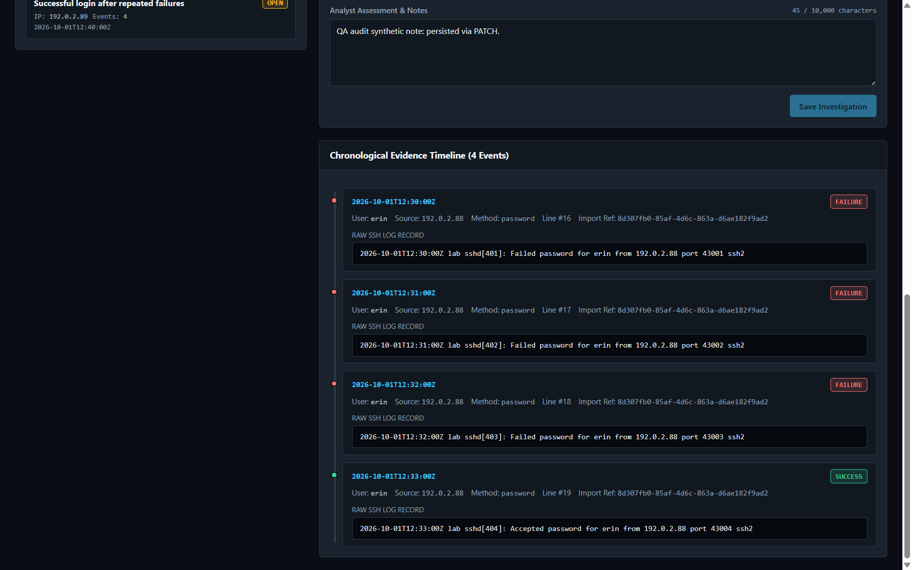

# SOC Auth Investigation

[Português](README.md)

Local Linux/SSH authentication investigation platform for SOC/Blue Team learning. React/TypeScript consumes FastAPI; PostgreSQL persists evidence and analyst decisions. Alerts are triage signals, never proof of compromise.

**Status:** demonstrable v1 approved by independent QA for local integration, with documented limitations. Import, saved investigations, keyboard navigation, mobile layout and browser report generation were verified. Single local analyst only. Do not expose this application to a network.

## Project in action



**Stack:** React · TypeScript · Vite · FastAPI · Python · PostgreSQL · Docker.

**Goal:** turn authentication lines into traceable triage evidence. Import logs, detect patterns, investigate, save a conclusion and export Markdown/JSON.

**Example:** three failed logins for `erin` at 12:30, 12:31 and 12:32 UTC followed by success at 12:33 from synthetic address `192.0.2.88`. Four records support a triage signal, not proof of compromise. Authorization and session/process context still need investigation. [Case analysis (Portuguese)](docs/portfolio-case.md).

UTC comparisons, SHA-256 deduplication with the first reference preserved, transactions and capacity limits make the investigation reproducible within the documented scope.

Built with AI agent assistance for implementation and review. Verification evidence and limitations are documented; test counts are not security certification.

## Run

Verified environment: Windows, Python 3.13.2, Node 22.23.2, npm 11.18.0, Docker Desktop and PostgreSQL 17. Python dependencies are listed in `backend/requirements.txt`; the current environment includes a Pydantic prerelease. Clean installation has not yet been verified. Install dependencies only in a development environment you control.

From the repository root:

```powershell
docker desktop start
powershell -NoProfile -File scripts/setup-db.ps1
$env:PYTHONPATH = "backend"
powershell -NoProfile -File scripts/with-env.ps1 python -m app.migrate up
powershell -NoProfile -File scripts/with-env.ps1 python -m uvicorn app.main:app --host 127.0.0.1 --port 8000
```

In another terminal, from `frontend/`, install approved dependencies with `npm ci`, then run:

```powershell
npm run dev
```

Open [the local interface](http://127.0.0.1:5173). Use this exact origin. API documentation: [FastAPI docs](http://127.0.0.1:8000/docs).

Setup generates a random database credential in ignored `.env`. Never share it. Docker volume persists data. `docker compose stop` preserves the database; removing volumes destroys it. The PostgreSQL image is pinned by digest. Migration `down` is destructive, requires `--confirm-database <exact-name>` and is not required for normal startup.

Allowed HTTP hosts: `127.0.0.1` and `localhost`. POST/PATCH require `Origin: http://127.0.0.1:5173`, including CLI clients; the browser supplies it automatically. This restricts cross-site requests but does not authenticate local processes. CLI examples are in [backend/README.md](backend/README.md).

## Walkthrough

1. Open **Ingest Logs** and upload `samples/lab_auth_v1.log`: a fresh database produces 35 events and six alerts.
2. Reimport: zero new events, 35 duplicates, same alerts.
3. Select an alert under **Alerts & Triage**; inspect rationale, false positives and chronological evidence.
4. Save notes, status and classification. Select another alert and reopen the original to verify persistence.
5. Export Markdown and JSON; compare evidence and saved notes.
6. Import `samples/invalid_lines_v1.log`: 13 lines, 11 invalid with explicit reasons. Valid records may already exist and count as duplicates.

See [scenarios](samples/SCENARIOS.md), [expected results](samples/expected_v1.json) and [demo procedure](docs/demo.md). Use synthetic logs only. The supported format requires RFC3339 timestamps with an offset; yearless syslog and extra OpenSSH suffixes are rejected explicitly.

## Check

From root:

```powershell
powershell -NoProfile -File scripts/with-env.ps1 python -m pytest backend/tests -q
```

From `frontend/`:

```powershell
npm run build
npm run test
```

Historical results in the documented environment: 140 backend tests with PostgreSQL, 25 frontend tests and a successful build. Frontend tests use JSDOM/mocked fetch. [Validation summary and limits (Portuguese)](docs/acceptance.md).

## Evidence and limitations

See the [demo procedure](docs/demo.md), [case analysis](docs/portfolio-case.md), [mobile tabs](docs/screenshots/mobile-tabs.png) and [mobile modal](docs/screenshots/mobile-modal.png). Real screenshots contain synthetic data only.

The publication review rechecked deduplication, four records in the `erin` case and report contents on the local service with equivalent code. Saving/reopening and mobile were checked earlier. The public copy has not been run in a clean environment. Security review was static/partial, not a security certification. Pydantic prerelease, clean installation and automatic disk downloads remain limitations. No authentication: do not expose the API or database to the internet.

## Design and limits

See [architecture](docs/architecture.md), [API/data contract](docs/CONTRACT.md), [backend instructions](backend/README.md) and [frontend instructions](frontend/README.md). Detailed design documents are in Portuguese; both READMEs explain execution.

No authentication: loopback only. Inputs are untrusted and never executed. Original-line SHA-256 deduplicates identical evidence across files, preserving its first reference. Three rules use documented 300-second windows. Full recomputation grows with total stored events; no evidence is silently truncated. The code is public for study and portfolio use; it is a local lab, not meant for production or internet exposure.

Global capacity: 50,000 unique events and 1,000 import records. Exceeding either rejects the whole import with 409, without deleting data. Duplicates consume no new event slots; every reimport consumes an import record.
