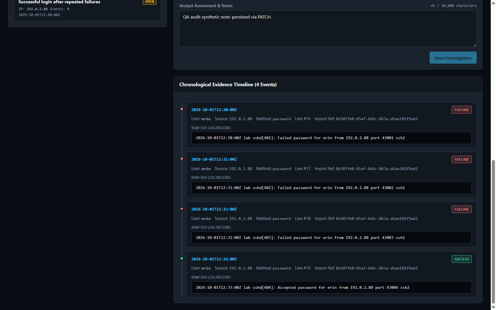

# SOC Auth Investigation

[English](README.en.md)

Plataforma local de investigação de autenticação Linux/SSH para estudo de SOC/Blue Team. Importa um formato SSH documentado, normaliza eventos em UTC, identifica três padrões e mantém conclusões do analista em PostgreSQL.

**Estado:** v1 demonstrável aprovada pelo QA para integração local, com ressalvas documentadas. Importação, investigação persistida, teclado, mobile e geração de relatórios foram verificados no navegador. Um alerta é sinal de triagem, nunca prova de invasão. Uso local por um analista; não exponha as portas em rede.

## Projeto em ação



**Stack:** React · TypeScript · Vite · FastAPI · Python · PostgreSQL · Docker.

**Problema:** transformar linhas de autenticação em evidências para triagem, sem confundir um alerta com invasão confirmada. Fluxo: importar, detectar, investigar, salvar conclusão e exportar.

**Caso demonstrativo:** três falhas de `erin` às 12:30, 12:31 e 12:32 UTC, seguidas de sucesso às 12:33, na origem sintética `192.0.2.88`. A regra reúne quatro evidências. A conclusão permanece inconclusiva: confirmar autorização da atividade e correlacionar sessão/processos antes de afirmar comprometimento. [Análise do caso](docs/portfolio-case.md).

**Decisões técnicas:** UTC para comparação temporal; SHA-256 e primeira referência para deduplicação; transações e limites para preservar consistência; notas persistidas e Markdown/JSON para comunicar a investigação.

Desenvolvido com assistência de agentes de IA em implementação e revisão. Resultados e limites registrados; quantidade de testes não equivale a certificação de segurança.

## Ambiente e início

Ambiente verificado: Windows, Python 3.13.2, Node 22.23.2, npm 11.18.0, Docker Desktop e PostgreSQL 17. As versões Python efetivamente usadas estão em [backend/requirements.txt](backend/requirements.txt). O ambiente atual contém Pydantic pré-release; instalação limpa ainda não validada. Instale as dependências apenas em um ambiente de desenvolvimento sob seu controle.

Na raiz do projeto:

```powershell
docker desktop start
powershell -NoProfile -File scripts/setup-db.ps1
$env:PYTHONPATH = "backend"
powershell -NoProfile -File scripts/with-env.ps1 python -m app.migrate up
powershell -NoProfile -File scripts/with-env.ps1 python -m uvicorn app.main:app --host 127.0.0.1 --port 8000
```

Em outro terminal, na pasta `frontend/`, após instalar as dependências aprovadas com `npm ci`:

```powershell
npm run dev
```

Abra [a interface local](http://127.0.0.1:5173). O backend fica em [API docs](http://127.0.0.1:8000/docs). Use exatamente `127.0.0.1:5173`, origem permitida pelo backend.

O setup gera credencial aleatória em `.env`, ignorado pelo Git. Não compartilhe esse arquivo. Banco principal `soc_auth` e teste `soc_auth_test` usam volume persistente Docker. Parar com `docker compose stop` preserva dados; não use remoção de volumes para reiniciar aplicação. A imagem PostgreSQL está fixada por digest. Migração `down` apaga dados, exige `--confirm-database <nome-exato>` e não faz parte do fluxo normal.

Host HTTP permitido: `127.0.0.1` ou `localhost`. POST/PATCH exigem `Origin: http://127.0.0.1:5173`, inclusive em clientes CLI; o navegador envia esse cabeçalho automaticamente. Isso restringe requisições de outros sites, mas não autentica processos locais. Exemplos CLI em [backend/README.md](backend/README.md).

## Primeiro exercício

1. Em **Ingest Logs**, importe `samples/lab_auth_v1.log`: em banco vazio, 35 eventos e seis alertas.
2. Reimporte: zero eventos novos, 35 duplicatas e os mesmos alertas.
3. Em **Alerts & Triage**, selecione alerta; confira regra, justificativa, falsos positivos e timeline.
4. Registre hipótese, classificação e estado; salve, selecione outro alerta e reabra para verificar persistência.
5. Exporte Markdown e JSON; compare notas e evidências.
6. Importe `samples/invalid_lines_v1.log`: 13 linhas, 11 inválidas com motivos. Dados válidos podem já existir e contar como duplicados.

Gabarito: [cenários](samples/SCENARIOS.md) e [resultados esperados](samples/expected_v1.json). Não use logs ou credenciais pessoais. Formato estrito RFC3339 com offset; syslog sem ano e sufixos extras de OpenSSH não são suportados nesta versão.

## Verificações

```powershell
powershell -NoProfile -File scripts/with-env.ps1 python -m pytest backend/tests -q
```

Em `frontend/`:

```powershell
npm run build
npm run test
```

Resultados históricos no ambiente documentado: 140 testes backend com PostgreSQL real, 25 frontend e build aprovado. Testes frontend usam JSDOM/fetch simulado. [Resumo de validação e limites](docs/acceptance.md).

## Demonstração e ressalvas

[Roteiro de demonstração](docs/demo.md), [caso investigado](docs/portfolio-case.md), [abas mobile](docs/screenshots/mobile-tabs.png) e [modal mobile](docs/screenshots/mobile-modal.png). Capturas reais contêm somente dados sintéticos.

A revisão de publicação confirmou reimportação sem duplicação, quatro evidências do caso `erin` e conteúdo dos relatórios no serviço local com código equivalente. Salvar/reabrir e mobile foram verificados anteriormente. A cópia pública ainda não foi executada em ambiente limpo. A revisão de segurança foi estática/parcial; não certifica segurança geral. Pydantic pré-release, instalação limpa e gravação de downloads em disco permanecem limitações. Sem autenticação: não hospede API ou banco abertos na internet.

## Organização e limites

- [Arquitetura](docs/architecture.md), [contrato](docs/CONTRACT.md), [roteiro de demonstração](docs/demo.md).
- [Backend](backend/README.md): parser, regras, SQL parametrizado, migração, API, relatórios.
- [Frontend](frontend/README.md): interface React, filtros, investigação e downloads.
- Sem autenticação; somente loopback. Conteúdo dos logs é dado não confiável e nunca é executado.
- SHA-256 da linha original evita duplicação; mesma linha idêntica de arquivos diferentes vira única evidência. Primeira referência é preservada.
- Regras usam janela de 300 s; parâmetros e limites inclusivos/exclusivos estão no contrato. Recomputação integral aumenta custo com total armazenado; nenhum truncamento silencioso.
- Capacidade global: 50.000 eventos únicos e 1.000 registros de importação. Ao exceder, a API recusa toda a importação com 409, sem remover dados. Duplicatas não consomem eventos novos; cada reimportação consome um registro de importação.
- Sem publicação pública. Revisão e autorização de publicação são etapas separadas.
