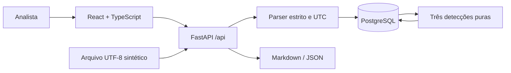

# Arquitetura

Aplicação local de analista único, com camadas separadas por responsabilidade.

`backend/app/parser.py` valida bytes, linhas, timestamps e endereços antes de persistir. Identidade SHA-256 evita duplicatas. Importações usam transação e lock consultivo; regras recalculam conjunto completo, preservando identidade estável dos alertas e investigação já salva.

Detecções usam índices de janela e evidências compartilhadas. Banco guarda âncora, origem, regra e usuário quando aplicável; detalhe reconstrói evidências por consulta. Assim, não armazena associações quadráticas. PostgreSQL mantém importações, eventos, alertas e investigações; migração SQL é versionada e transacional.

Frontend usa estado React e fetch, sem router, gerência global, biblioteca visual ou ativos externos. API fornece paginação; indicadores são globais. Timeline e relatório apresentam dados como evidência, sem transformar alerta em conclusão automática.

Limites de confiança: upload, query string e notas são validados; SQL parametrizado; nomes de arquivo não viram caminhos; React renderiza conteúdo como texto. Banco e servidores usam loopback. Host é restrito a `127.0.0.1`/`localhost`; POST/PATCH exigem Origin exato da interface. Esses controles não autenticam processos locais: qualquer processo com acesso ao loopback pode enviar os cabeçalhos aceitos. Credenciais geradas ficam em `.env` ignorado e não entram no navegador.

Sob o lock de importação, a API verifica capacidade antes de gravar: 50.000 eventos únicos e 1.000 registros de importação. Exceder retorna 409 com rollback integral, sem truncamento ou remoção automática. A migração destrutiva exige confirmação do nome real do banco dentro da transação. A imagem PostgreSQL é fixada por digest da imagem já disponível.

Limitações: formato SSH estrito, recomputação integral, resposta completa de evidências de um alerta e ausência de concorrência entre analistas. Conjunto Python atual inclui pré-release; ambiente limpo ainda precisa ser validado. Contrato detalhado em CONTRACT.md.
